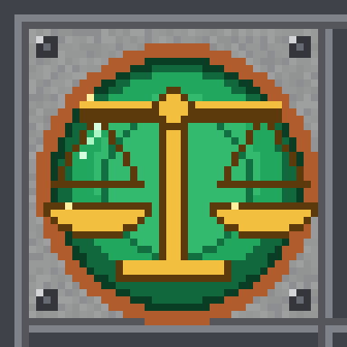
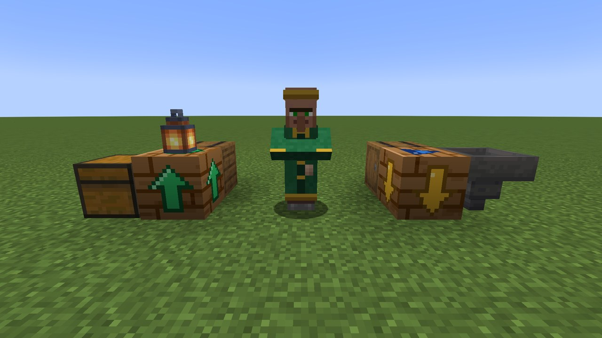
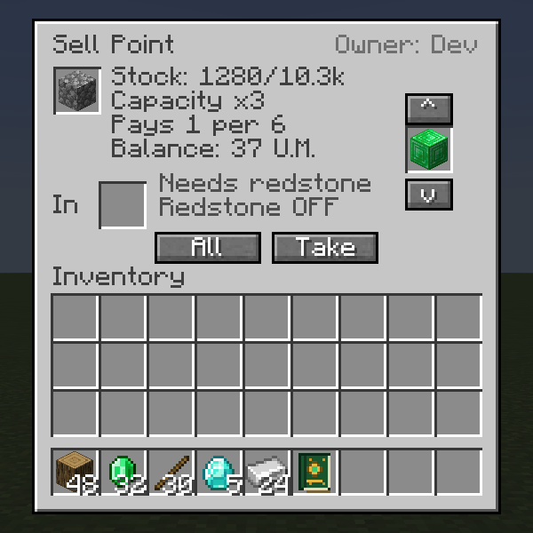
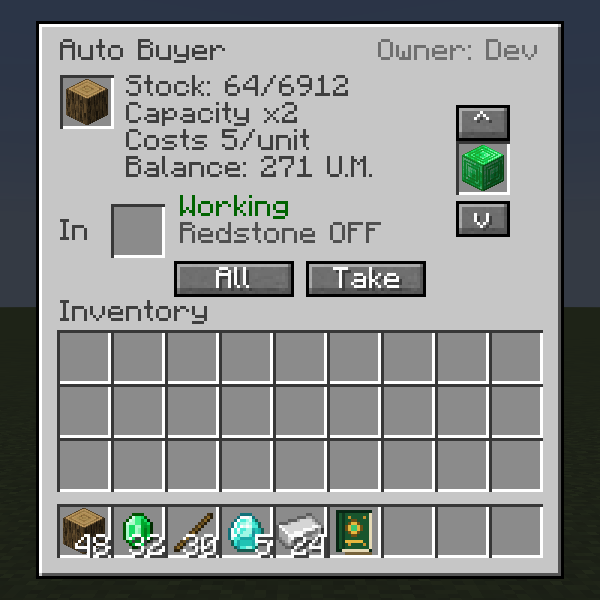
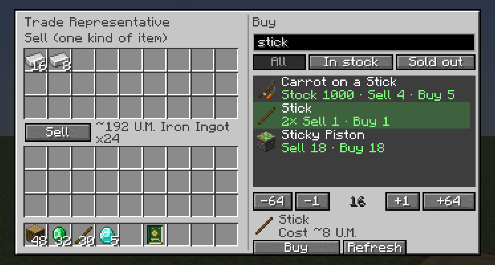
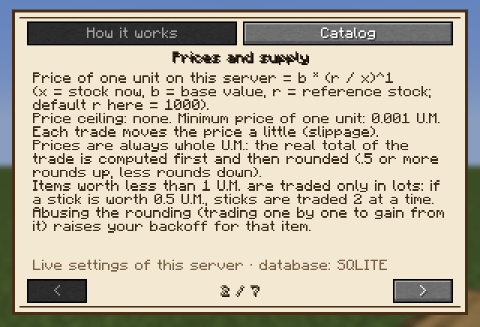
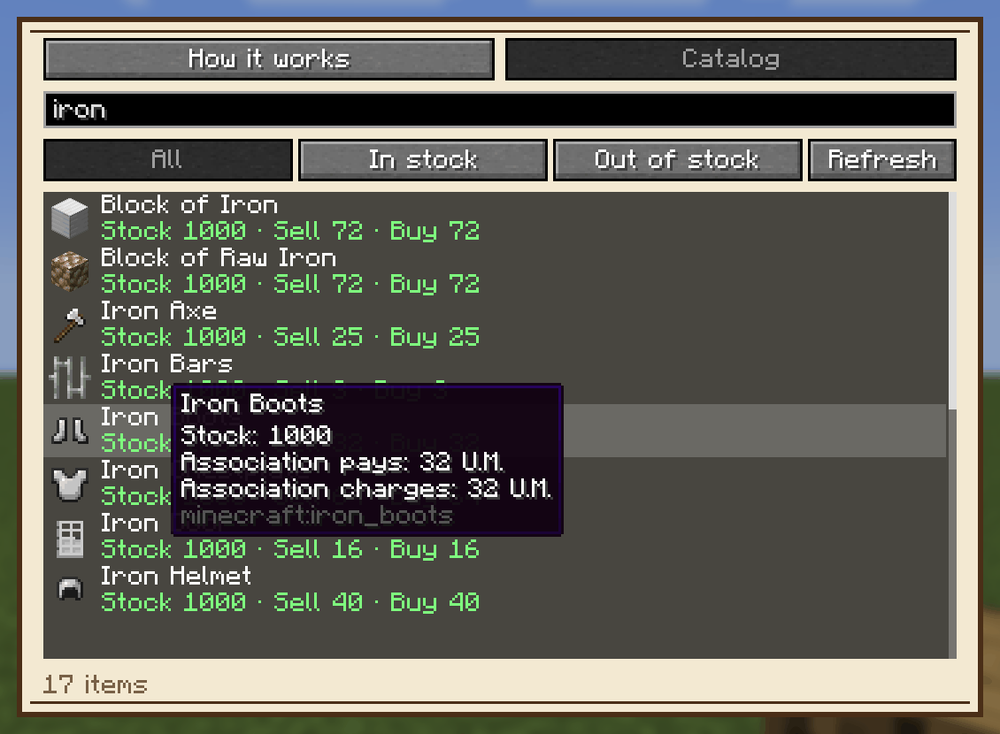
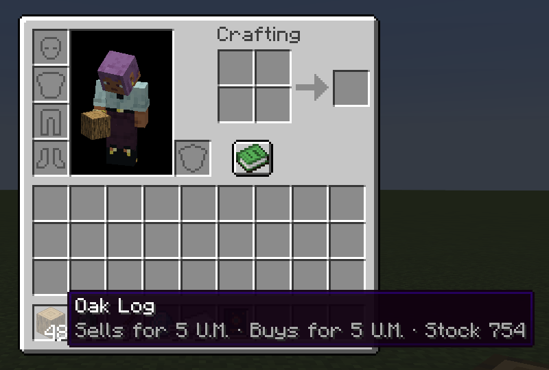

<p align="center">
  
</p>

<h1 align="center">Free Trade</h1>

<p align="center">
  A supply-and-demand economy for NeoForge modpacks and servers.
</p>

<p align="center">
  <b>English</b> | <a href="README.pt-BR.md">Português (Brasil)</a>
</p>

<p align="center">
  <a href="https://github.com/mzramna/freetrade/releases/latest"></a>
  <a href="LICENSE"></a>
  <a href="https://github.com/mzramna/freetrade/actions/workflows/build.yml"></a>
  
  
</p>

<p align="center">
  
</p>

Free Trade adds a global **Trade Association** that keeps the stock of every item on the server. Prices follow supply:
plentiful items get cheaper and scarce items get more expensive. Items that nobody declared get a value from their
recipes, so modded items are priced automatically. Players trade with the market through Trade Representative
villagers, Sell Points and Auto Buyers.

## Features

- **Supply-based prices.** Each item has a base value and a formula that moves its price with its stock. The default
  formula is `b * (r / x)^1`. A server can change it, add a price ceiling, or use a steeper curve.
- **Living market.** Large trades move the price unit by unit (slippage), and every trade is rounded to whole U.M.
- **Lots for cheap items.** Items worth less than 1 U.M. are traded in lots, so a stick worth 0.5 U.M. is sold 2 at a time.
- **Values from recipes.** Items without a declared value get one from the cheapest recipe that makes them. When
  ingredient prices move, derived items move with them.
- **Trade Representative.** An unemployed villager becomes a representative at an Auto Buyer. Sell one item type to it,
  or buy from its catalog.
- **Sell Point and Auto Buyer.** Machines that sell an item on a redstone signal, or buy an item with the money you put
  in them. Their capacity grows with chests and barrels touching them, and a Sell Point can work as a change machine.
- **Trade Association Guide.** A book that explains the market with this server's own settings, and a searchable catalog
  of buy and sell prices and stock. Server admins can hide the catalog from players.
- **Price tooltips.** Hover over an item in your inventory to see what the association pays and charges.
- **Money.** Emeralds and emerald blocks by default, any items the server chooses, and Lightman's Currency coins and bank
  accounts when that mod is installed.
- **Taxes, backoff and treasury.** Optional sell and buy taxes into an operator account, as a percentage or a fixed
  amount per unit, set globally or per item. An anti-storage backoff against round trips and rounding abuse, and an
  optional finite treasury.
- **Triggers.** Command-block friendly queries such as `/freetrade treasury query >= 1000`, and commands that run when an
  account reaches a condition.
- **Admin tools.** `/freetrade stock`, `forceprice`, `recalc`, and base values declared in `values.json`.
- **Databases.** SQLite for a single world, or PostgreSQL, which several servers can share as one economy.
- **Translatable.** English and Brazilian Portuguese are included. See [TRANSLATING.md](TRANSLATING.md) to add a language.

<table>
  <tr>
    <td width="50%">
      
      <br><sub><b>Sell Point</b>: target item, stock, capacity, balance and money selector.</sub>
    </td>
    <td width="50%">
      
      <br><sub><b>Auto Buyer</b>: buying oak logs with the money put into the block.</sub>
    </td>
  </tr>
  <tr>
    <td>
      
      <br><sub><b>Trade Representative</b>: sell one item type, or search the catalog to buy.</sub>
    </td>
    <td>
      
      <br><sub><b>Trade Association Guide</b>: the pages show this server's live price formula and settings.</sub>
    </td>
  </tr>
  <tr>
    <td>
      
      <br><sub><b>Catalog</b>: searchable sell and buy prices, with stock.</sub>
    </td>
    <td>
      
      <br><sub><b>Price tooltip</b>: sell and buy prices shown on hover.</sub>
    </td>
  </tr>
</table>

## Quick start

1. **Download** the jar for your Minecraft version from the [Downloads](#downloads) table.
2. **Install** it on the server and on every client.
3. **Read the market.** Craft a **Trade Association Guide** from a book and an emerald, then right-click it.
4. **Trade.** Place an **Auto Buyer** next to an unemployed villager. The villager becomes a Trade Representative, and
   right-clicking it opens the trade window.

Server owners and modpack makers: settings live in `config/freetrade-server.toml`, base values in
`config/freetrade/values.json`, and `/freetrade recalc` updates recipe values after you add mods. The
[server and modpack guide](docs/en/server-modpack-guide.md) covers the details.

## Downloads

Get the jar from the [latest release](https://github.com/mzramna/freetrade/releases/latest). Install it on **both the
server and the clients**. Every server that shares an economy must run the same modpack.

| Jar | Minecraft | NeoForge | Java | Notes |
|-----|-----------|----------|------|-------|
| `freetrade-1.21.1-0.1.0.jar` | 1.21.1 | 21.1.x | 21 | JEI and EMI drag-and-drop. |
| `freetrade-26.1.2-0.1.0.jar` | 26.1.2 | 26.1.x | 25 | JEI only. EMI has no 26.1 build yet. |

## Documentation

- [Player guide](docs/en/player-guide.md): how to trade, and how the market works.
- [Server and modpack guide](docs/en/server-modpack-guide.md): installing, databases, shared economies, modpack seeding,
  economy settings and troubleshooting.
- [Configuration reference](docs/en/configuration.md): every server setting, the `values.json` format, and the price
  formula language.
- [Command reference](docs/en/commands.md): every `/freetrade` command (also `/ft`), with permissions and examples.
- [Regional markets](docs/regions.md): a design note for a possible future version. It is not implemented.

## Also by the author

- [ModLock](https://github.com/mzramna/modlock): per-player, per-mod hand-crafting locks for progression modpacks.

## Translations

Free Trade is available in English and Brazilian Portuguese. To add a language, translate the game text, the
documentation, or both. See [TRANSLATING.md](TRANSLATING.md).

## Building

| Branch   | Minecraft | Java |
|----------|-----------|------|
| `1.21.1` | 1.21.1    | 21   |
| `26.1`   | 26.1.2    | 25   |

```bash
./gradlew build              # jar in build/libs
./gradlew runGameTestServer  # automated GameTests
```

CI runs build and GameTests on every push and pull request. Pushing a `v*` tag, or pushing to the `release` branch,
publishes a release with the built jars.

Report bugs and suggest features in the [issue tracker](https://github.com/mzramna/freetrade/issues).

## License

[MIT](LICENSE)
