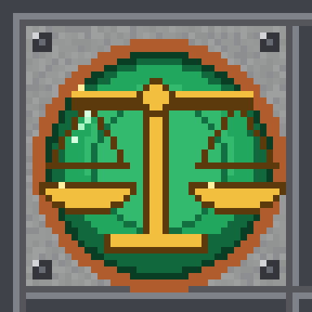
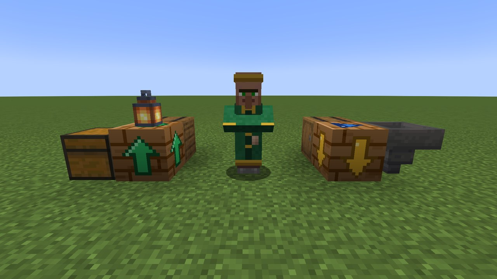
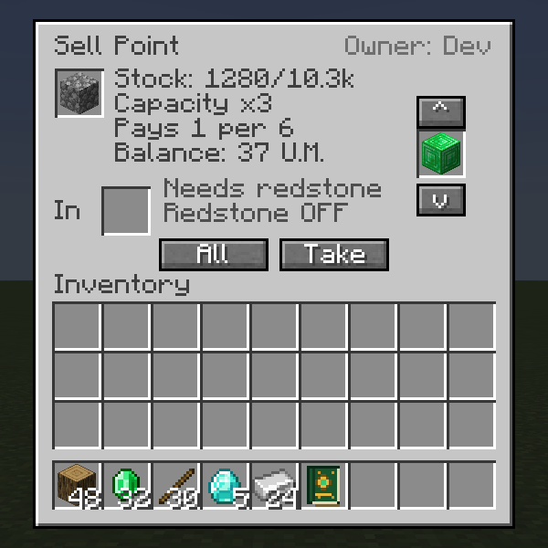
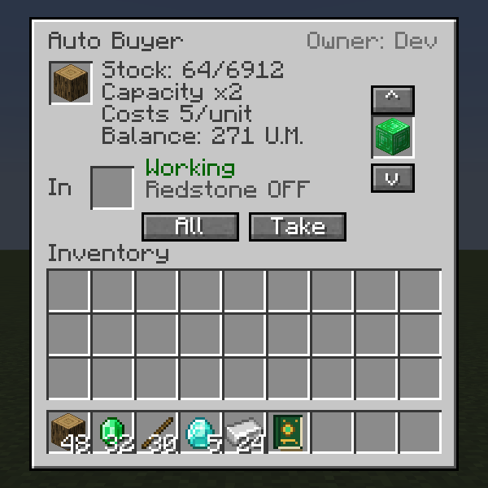
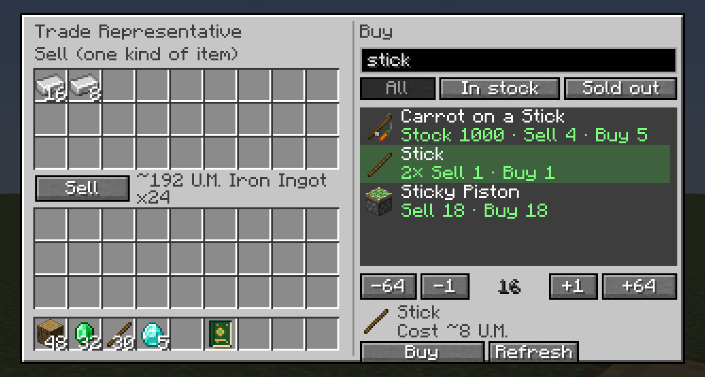
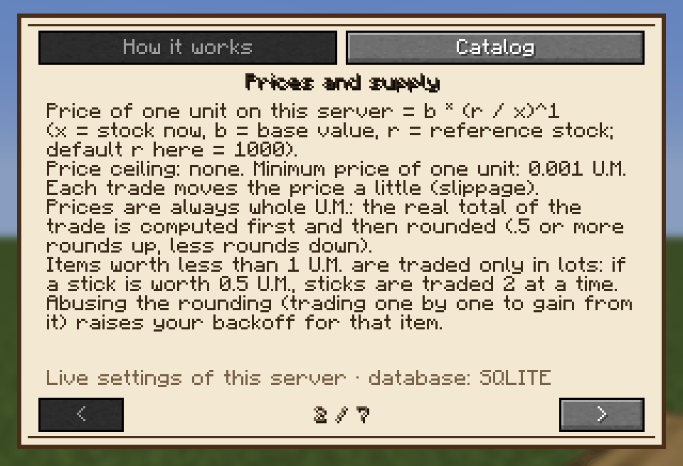
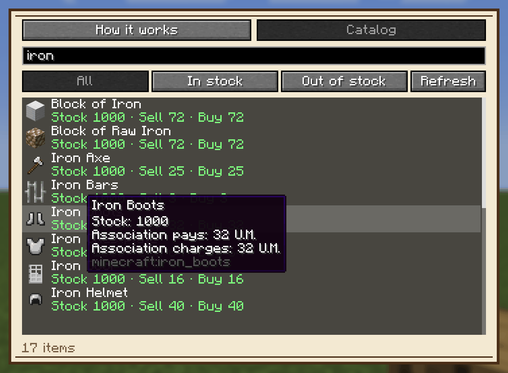
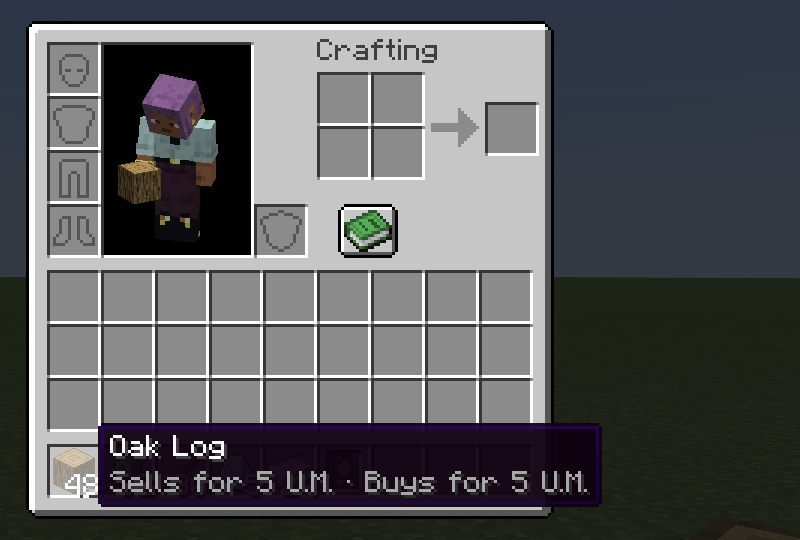

<p align="center">
  
</p>

<h1 align="center">Livre Comércio (Free Trade)</h1>

<p align="center">
  Uma economia de oferta e demanda para modpacks e servidores NeoForge.
</p>

<p align="center">
  <a href="README.md">English</a> | <b>Português (Brasil)</b>
</p>

<p align="center">
  <a href="https://github.com/mzramna/freetrade/releases/latest"></a>
  <a href="LICENSE"></a>
  <a href="https://github.com/mzramna/freetrade/actions/workflows/build.yml"></a>
  
  
</p>

<p align="center">
  
</p>

O Livre Comércio adiciona uma **Associação Comercial** global, que guarda o estoque de todos os itens do servidor. Os
preços seguem a oferta: itens abundantes ficam mais baratos e itens escassos ficam mais caros. Itens que ninguém declarou
recebem um valor a partir das suas receitas, então os itens de outros mods também ganham preço automaticamente. Os
jogadores negociam com o mercado por meio de aldeões Representantes Comerciais, Pontos de Venda e Compras Automáticas.

## Recursos

- **Preços pela oferta.** Cada item tem um valor base e uma fórmula que move o preço conforme o estoque. A fórmula padrão é
  `b * (r / x)^1`. O servidor pode mudá-la, colocar um teto de preço ou usar uma curva mais íngreme.
- **Mercado vivo.** Negociações grandes movem o preço unidade por unidade (derrapagem), e cada negociação é arredondada para
  U.M. inteiras.
- **Lotes para itens baratos.** Itens que valem menos de 1 U.M. são negociados em lotes, então um graveto que vale 0,5 U.M.
  é vendido 2 por vez.
- **Valores pelas receitas.** Itens sem valor declarado recebem um valor da receita mais barata que os fabrica. Quando os
  preços dos ingredientes mudam, os itens derivados acompanham.
- **Representante Comercial.** Um aldeão desempregado vira representante em uma Compra Automática. Venda um tipo de item para
  ele, ou compre do catálogo dele.
- **Ponto de Venda e Compra Automática.** Máquinas que vendem um item com sinal de redstone, ou compram um item com o dinheiro
  que você coloca nelas. A capacidade cresce com baús e barris encostados, e o Ponto de Venda pode funcionar como
  máquina de troco.
- **Guia da Associação Comercial.** Um livro que explica o mercado com as configurações do próprio servidor, e um catálogo
  pesquisável com preços de compra e venda e estoque. Os administradores podem esconder o catálogo dos jogadores.
- **Dicas de preço.** Passe o mouse sobre um item no inventário para ver quanto a associação paga e cobra.
- **Dinheiro.** Esmeraldas e blocos de esmeralda por padrão, outros itens se o servidor escolher, e moedas e contas bancárias
  do Lightman's Currency quando esse mod está instalado.
- **Impostos, backoff e tesouraria.** Impostos opcionais de venda e compra para uma conta de operadores, um backoff
  anti-armazenamento contra idas e voltas e abuso de arredondamento, e uma tesouraria finita opcional.
- **Gatilhos.** Consultas para blocos de comando, como `/freetrade treasury query >= 1000`, e comandos que rodam quando uma
  conta chega a uma condição.
- **Ferramentas de administração.** `/freetrade stock`, `forceprice`, `recalc`, e valores base declarados no `values.json`.
- **Bancos de dados.** SQLite para um mundo só, ou PostgreSQL, que vários servidores podem compartilhar como uma economia.
- **Traduzível.** Já inclui inglês e português do Brasil. Veja [TRANSLATING.md](TRANSLATING.md) para adicionar um idioma.

<table>
  <tr>
    <td width="50%">
      
      <br><sub><b>Ponto de Venda</b>: item alvo, estoque, capacidade, saldo e seletor de dinheiro.</sub>
    </td>
    <td width="50%">
      
      <br><sub><b>Compra Automática</b>: comprando troncos de carvalho com o dinheiro colocado no bloco.</sub>
    </td>
  </tr>
  <tr>
    <td>
      
      <br><sub><b>Representante Comercial</b>: venda um tipo de item, ou pesquise o catálogo para comprar.</sub>
    </td>
    <td>
      
      <br><sub><b>Guia da Associação Comercial</b>: as páginas mostram a fórmula de preço e as configurações atuais do servidor.</sub>
    </td>
  </tr>
  <tr>
    <td>
      
      <br><sub><b>Catálogo</b>: preços de venda e compra pesquisáveis, com estoque.</sub>
    </td>
    <td>
      
      <br><sub><b>Dica de preço</b>: preços de venda e compra mostrados ao passar o mouse.</sub>
    </td>
  </tr>
</table>

## Início rápido

1. **Baixe** o jar da sua versão do Minecraft na tabela de [Downloads](#downloads).
2. **Instale** no servidor e em todos os clientes.
3. **Leia o mercado.** Crafte um **Guia da Associação Comercial** com um livro e uma esmeralda, e clique com o botão direito nele.
4. **Negocie.** Coloque uma **Compra Automática** perto de um aldeão desempregado. O aldeão vira Representante Comercial,
   e clicar com o botão direito nele abre a janela de negociação.

Donos de servidor e criadores de modpack: as configurações ficam em `config/freetrade-server.toml`, os valores base em
`config/freetrade/values.json`, e `/freetrade recalc` atualiza os valores das receitas depois que você adiciona mods. O
[guia do servidor e do modpack](docs/pt-br/server-modpack-guide.md) traz os detalhes.

## Downloads

Baixe o jar na [versão mais recente](https://github.com/mzramna/freetrade/releases/latest). Instale **no servidor e nos
clientes**. Todo servidor que compartilha uma economia deve usar o mesmo modpack.

| Jar | Minecraft | NeoForge | Java | Observações |
|-----|-----------|----------|------|-------------|
| `freetrade-1.21.1-0.1.0.jar` | 1.21.1 | 21.1.x | 21 | Arrastar itens com JEI e EMI. |
| `freetrade-26.1.2-0.1.0.jar` | 26.1.2 | 26.1.x | 25 | Só JEI. O EMI ainda não tem versão para 26.1. |

## Documentação

- [Guia do jogador](docs/pt-br/player-guide.md): como negociar e como o mercado funciona.
- [Guia do servidor e do modpack](docs/pt-br/server-modpack-guide.md): instalação, bancos de dados, economias compartilhadas,
  valores para modpacks, configurações econômicas e solução de problemas.
- [Referência de configuração](docs/pt-br/configuration.md): todas as configurações do servidor, o formato do `values.json` e
  a linguagem da fórmula de preço.
- [Referência de comandos](docs/pt-br/commands.md): todos os comandos `/freetrade` (também `/ft`), com permissões e exemplos.
- [Mercados regionais](docs/regions.md): uma nota de projeto para uma possível versão futura. Não está implementado.

## Também do autor

- [ModLock](https://github.com/mzramna/modlock): travas por jogador e por mod para fabricação manual, em modpacks com progressão.

## Traduções

O Livre Comércio está disponível em inglês e em português do Brasil. Para adicionar um idioma, traduza o texto do jogo, a
documentação, ou os dois. Veja [TRANSLATING.md](TRANSLATING.md).

## Compilação

| Branch   | Minecraft | Java |
|----------|-----------|------|
| `1.21.1` | 1.21.1    | 21   |
| `26.1`   | 26.1.2    | 25   |

```bash
./gradlew build              # jar em build/libs
./gradlew runGameTestServer  # GameTests automáticos
```

O CI roda build e GameTests a cada push e pull request. Um push de tag `v*`, ou um push para o branch `release`, publica um
release com os jars compilados.

Relate bugs e sugira recursos no [gerenciador de issues](https://github.com/mzramna/freetrade/issues).

## Licença

[MIT](LICENSE)
