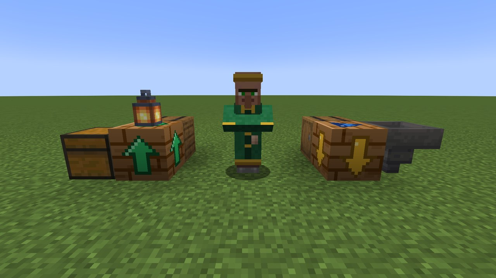
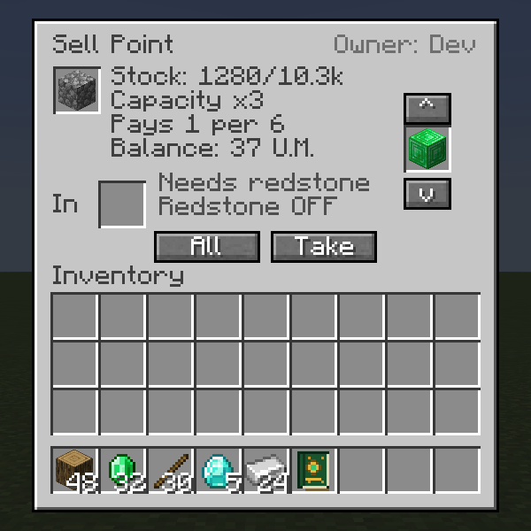
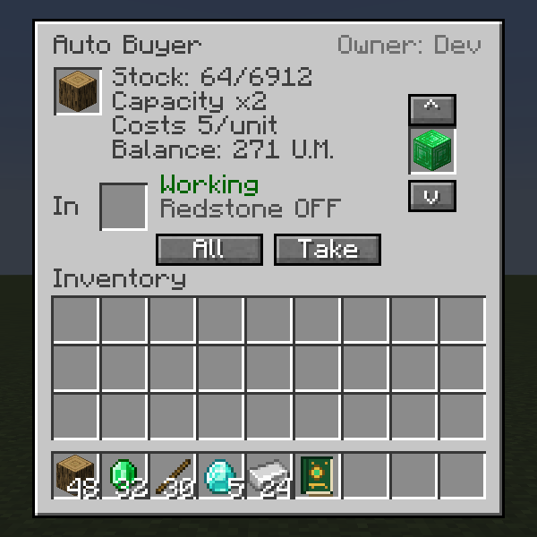
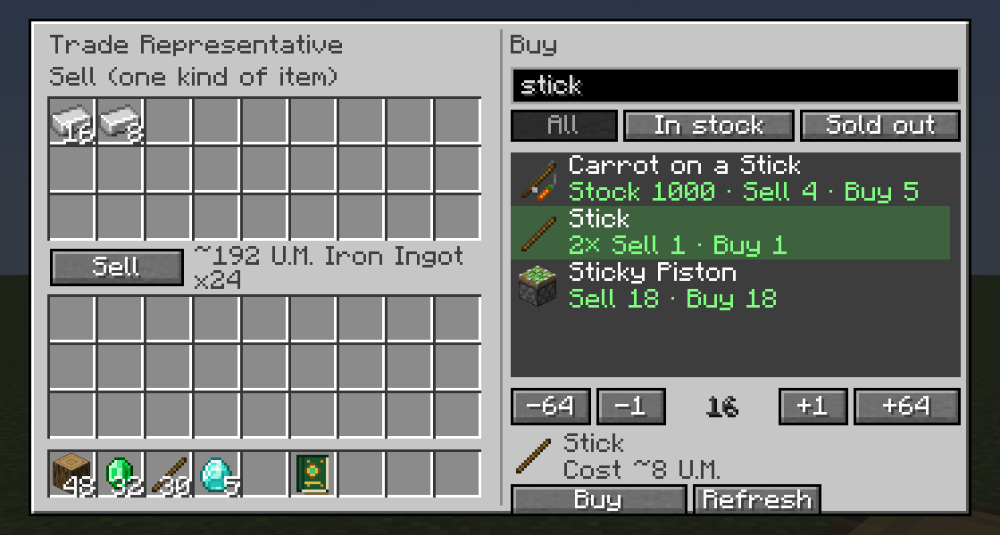
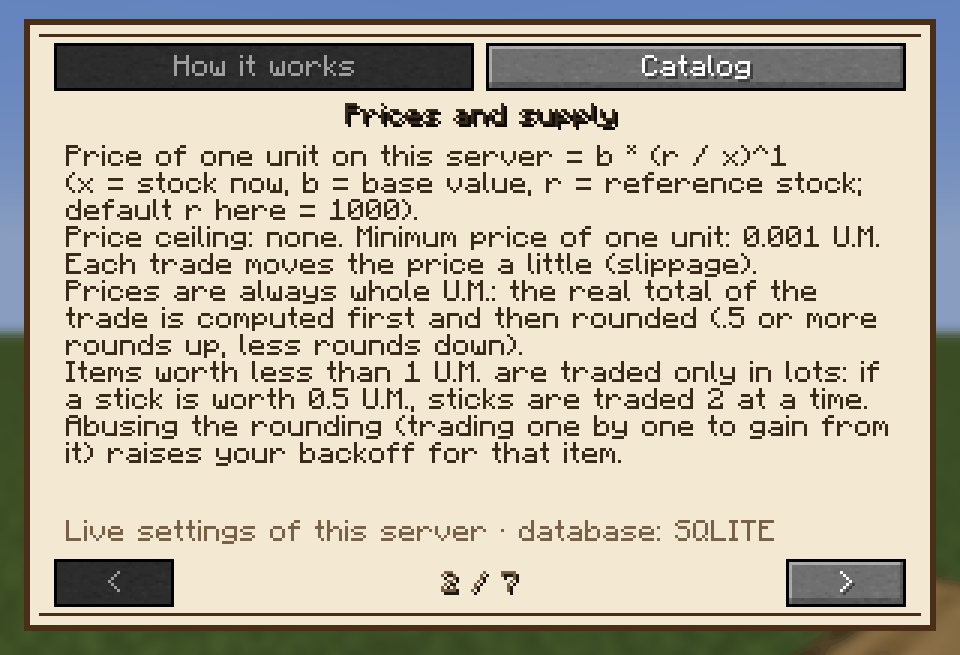
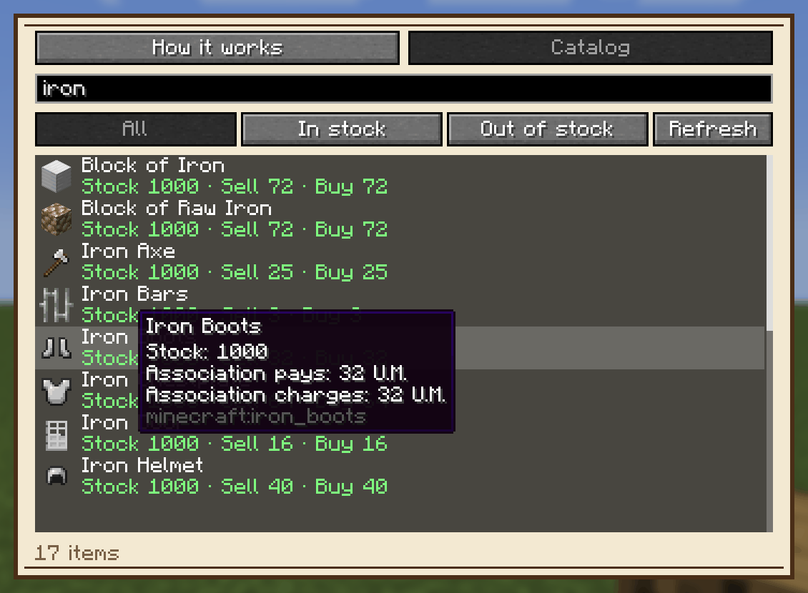
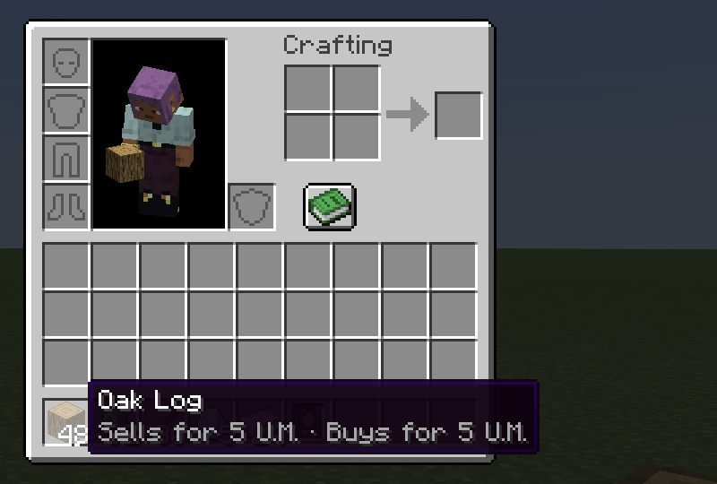

# Free Trade

**Free Trade** is a NeoForge economy mod for modpacks and servers. A global **Trade Association** keeps the stock of every
item on the server, and prices follow supply: plentiful items get cheaper, scarce items get more expensive. Items nobody
declared get a value from their recipes, so modded items are priced automatically.

## Features

- **Supply-based prices.** Each item has a base value and a formula that moves its price with its stock. Servers can change
  the formula, add a price ceiling, or use a steeper curve.
- **Living market.** Large trades move the price unit by unit, and every trade is rounded to whole U.M.
- **Lots for cheap items.** Items worth less than 1 U.M. are traded in lots, so cheap items always cost whole U.M.
- **Values from recipes.** Items without a declared value are priced from the cheapest recipe that makes them, and derived
  items follow their ingredients.
- **Trade Representative villagers.** An unemployed villager becomes a representative at an Auto Buyer. Sell one item type
  to it, or buy from its catalog.
- **Sell Point and Auto Buyer.** Machines that sell an item on a redstone signal, or buy an item with the money you put in
  them. Their capacity grows with chests and barrels touching them. A Sell Point can also work as a change machine.
- **Trade Association Guide.** A book that explains the market with this server's own settings, plus a searchable catalog
  of buy and sell prices and stock. Server admins can hide the catalog from players.
- **Price tooltips.** Hover over an item in your inventory to see what the association pays and charges.
- **Money.** Emeralds and emerald blocks by default, any items the server chooses, and Lightman's Currency coins and bank
  accounts when that mod is installed.
- **Taxes, backoff and treasury.** Optional sell and buy taxes into an operator account, an anti-storage backoff against
  round trips and rounding abuse, and an optional finite treasury.
- **Triggers and commands.** Commands for command blocks, such as a treasury query for a comparator, and triggers that run
  a command when an account reaches a condition.
- **Admin tools.** Adjust stock, force a fixed price, recalculate recipe values, and declare base values in `values.json`.
- **Databases.** SQLite for a single world, or PostgreSQL, which several servers can share as one economy.
- **Translatable.** English and Brazilian Portuguese are included.

## Screenshots

## How to start

1. Install the jar for your Minecraft version on the **server** and on **every client**.
2. Craft a **Trade Association Guide** from a book and an emerald, and right-click it to read the market.
3. To trade, place an **Auto Buyer** next to an unemployed villager. It becomes a Trade Representative. Right-click it to
   open the trade window.
4. Server owners: set the economy in `config/freetrade-server.toml`, declare item values in `config/freetrade/values.json`,
   and run `/freetrade recalc` after you add mods.

Sell Points are crafted with a wooden chest and a hopper. Auto Buyers are crafted with a barrel and a hopper. The
[player guide](https://github.com/mzramna/freetrade/blob/1.21.1/docs/en/player-guide.md) explains both.

## Compatibility

- **Minecraft 1.21.1** with NeoForge 21.1.x, on Java 21.
- **Minecraft 26.1.2** with NeoForge 26.1.x, on Java 25.
- **JEI and EMI** (1.21.1): drag items onto the Sell Point and Auto Buyer target slots. On 26.1, only **JEI** is supported,
  because EMI has no 26.1 build yet.
- **Lightman's Currency** is optional. It adds its coins as money and a bank option for trades.
- **PostgreSQL** is optional. SQLite is used by default. PostgreSQL lets several servers share one economy.
- **Install on the server and on the clients.** Every server that shares an economy must run the same modpack.

## Documentation

- [Player guide](https://github.com/mzramna/freetrade/blob/1.21.1/docs/en/player-guide.md): how to trade, and how the market works.
- [Server and modpack guide](https://github.com/mzramna/freetrade/blob/1.21.1/docs/en/server-modpack-guide.md): installing,
  databases, shared economies, modpack seeding and troubleshooting.
- [Configuration reference](https://github.com/mzramna/freetrade/blob/1.21.1/docs/en/configuration.md): every server setting,
  the `values.json` format, and the price formula language.
- [Command reference](https://github.com/mzramna/freetrade/blob/1.21.1/docs/en/commands.md): every `/freetrade` command, also
  available as `/ft`.

Bug reports and ideas: [issue tracker](https://github.com/mzramna/freetrade/issues).

## Also by the author

[ModLock](https://github.com/mzramna/modlock) gives per-player, per-mod hand-crafting locks for progression modpacks.

## License

Free Trade is released under the [MIT License](https://github.com/mzramna/freetrade/blob/1.21.1/LICENSE).
