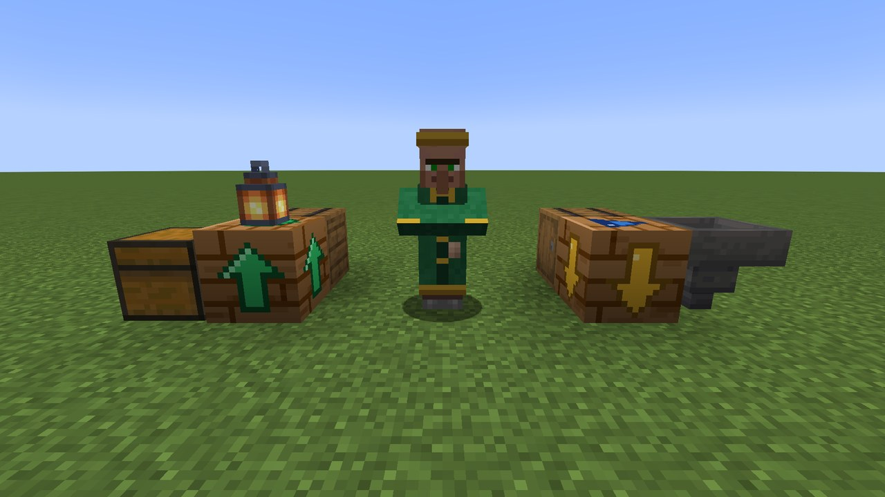
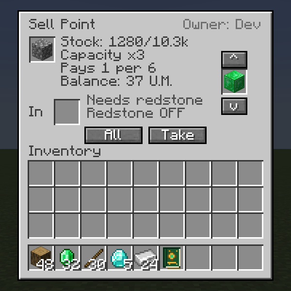
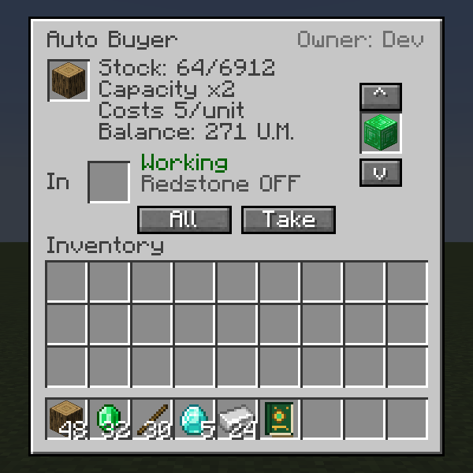
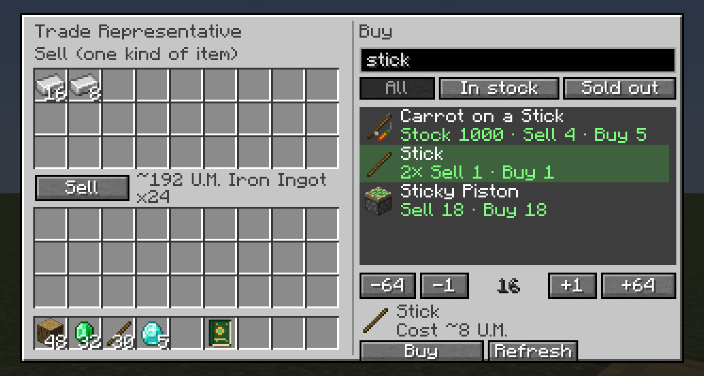
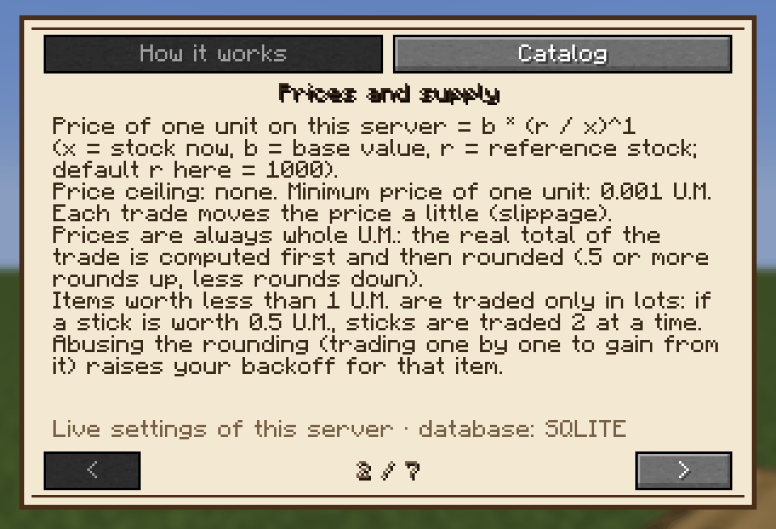
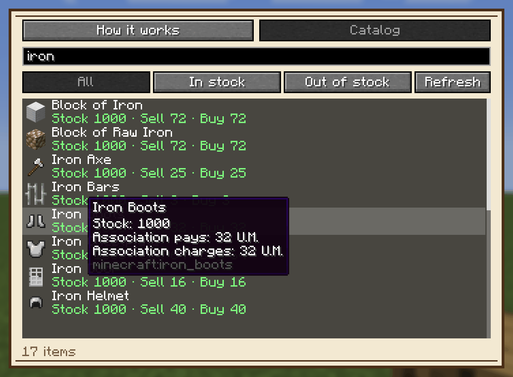
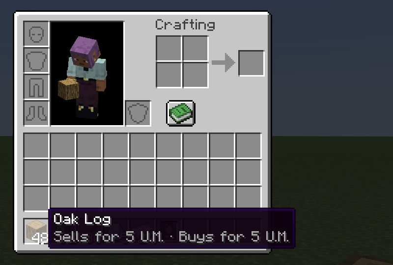

# Livre Comércio (Free Trade)

**Livre Comércio** é um mod de economia para NeoForge, feito para modpacks e servidores. Uma **Associação Comercial**
global guarda o estoque de todos os itens do servidor, e os preços seguem a oferta: itens abundantes ficam mais baratos,
e itens escassos ficam mais caros. Itens que ninguém declarou recebem um valor a partir das suas receitas, então os itens
de outros mods também ganham preço automaticamente.

## Recursos

- **Preços pela oferta.** Cada item tem um valor base e uma fórmula que move o preço conforme o estoque. O servidor pode
  mudar a fórmula, colocar um teto de preço ou usar uma curva mais íngreme.
- **Mercado vivo.** Negociações grandes movem o preço unidade por unidade, e cada negociação é arredondada para U.M. inteiras.
- **Lotes para itens baratos.** Itens que valem menos de 1 U.M. são negociados em lotes, então eles sempre custam U.M. inteiras.
- **Valores pelas receitas.** Itens sem valor declarado recebem preço pela receita mais barata que os fabrica, e os itens
  derivados acompanham os ingredientes.
- **Aldeões Representantes Comerciais.** Um aldeão desempregado vira representante em uma Compra Automática. Venda um tipo
  de item para ele, ou compre do catálogo dele.
- **Ponto de Venda e Compra Automática.** Máquinas que vendem um item com sinal de redstone, ou compram um item com o dinheiro
  que você coloca nelas. A capacidade cresce com baús e barris encostados. O Ponto de Venda também pode funcionar como
  máquina de troco.
- **Guia da Associação Comercial.** Um livro que explica o mercado com as configurações do próprio servidor, mais um catálogo
  pesquisável com preços de compra e venda e estoque. Os administradores podem esconder o catálogo dos jogadores.
- **Dicas de preço.** Passe o mouse sobre um item no inventário para ver quanto a associação paga e cobra.
- **Dinheiro.** Esmeraldas e blocos de esmeralda por padrão, outros itens se o servidor escolher, e moedas e contas bancárias
  do Lightman's Currency quando esse mod está instalado.
- **Impostos, backoff e tesouraria.** Impostos opcionais de venda e compra para uma conta de operadores, um backoff
  anti-armazenamento contra idas e voltas e abuso de arredondamento, e uma tesouraria finita opcional.
- **Gatilhos e comandos.** Comandos para blocos de comando, como uma consulta de tesouraria para um comparador, e gatilhos que
  rodam um comando quando uma conta chega a uma condição.
- **Ferramentas de administração.** Ajuste o estoque, fixe um preço, recalcule os valores das receitas e declare valores base
  no `values.json`.
- **Bancos de dados.** SQLite para um mundo só, ou PostgreSQL, que vários servidores podem compartilhar como uma economia.
- **Traduzível.** Inclui inglês e português do Brasil.

## Capturas de tela

## Como começar

1. Instale o jar da sua versão do Minecraft no **servidor** e em **todos os clientes**.
2. Crafte um **Guia da Associação Comercial** com um livro e uma esmeralda, e clique com o botão direito nele para ler o mercado.
3. Para negociar, coloque uma **Compra Automática** perto de um aldeão desempregado. Ele vira Representante Comercial. Clique
   com o botão direito nele para abrir a janela de negociação.
4. Donos de servidor: ajuste a economia em `config/freetrade-server.toml`, declare os valores dos itens em
   `config/freetrade/values.json`, e rode `/freetrade recalc` depois de adicionar mods.

O Ponto de Venda é feito com um baú de madeira e um funil. A Compra Automática é feita com um barril e um funil. O
[guia do jogador](https://github.com/mzramna/freetrade/blob/1.21.1/docs/pt-br/player-guide.md) explica os dois.

## Compatibilidade

- **Minecraft 1.21.1** com NeoForge 21.1.x, em Java 21.
- **Minecraft 26.1.2** com NeoForge 26.1.x, em Java 25.
- **JEI e EMI** (1.21.1): arraste itens para os campos-alvo do Ponto de Venda e da Compra Automática. Na 26.1, só o **JEI** é
  suportado, porque o EMI ainda não tem versão para 26.1.
- **Lightman's Currency** é opcional. Ele adiciona as moedas como dinheiro e uma opção de banco para as negociações.
- **PostgreSQL** é opcional. Por padrão é usado o SQLite. Com o PostgreSQL, vários servidores podem compartilhar uma economia.
- **Instale no servidor e nos clientes.** Todo servidor que compartilha uma economia deve usar o mesmo modpack.

## Documentação

- [Guia do jogador](https://github.com/mzramna/freetrade/blob/1.21.1/docs/pt-br/player-guide.md): como negociar e como o
  mercado funciona.
- [Guia do servidor e do modpack](https://github.com/mzramna/freetrade/blob/1.21.1/docs/pt-br/server-modpack-guide.md):
  instalação, bancos de dados, economias compartilhadas, valores para modpacks e solução de problemas.
- [Referência de configuração](https://github.com/mzramna/freetrade/blob/1.21.1/docs/pt-br/configuration.md): todas as
  configurações do servidor, o formato do `values.json` e a linguagem da fórmula de preço.
- [Referência de comandos](https://github.com/mzramna/freetrade/blob/1.21.1/docs/pt-br/commands.md): todos os comandos
  `/freetrade`, também disponíveis como `/ft`.

Relatos de bugs e ideias: [gerenciador de issues](https://github.com/mzramna/freetrade/issues).

## Também do autor

[ModLock](https://github.com/mzramna/modlock) oferece travas por jogador e por mod para fabricação manual, em modpacks com
progressão.

## Licença

O Livre Comércio é distribuído sob a [Licença MIT](https://github.com/mzramna/freetrade/blob/1.21.1/LICENSE).
